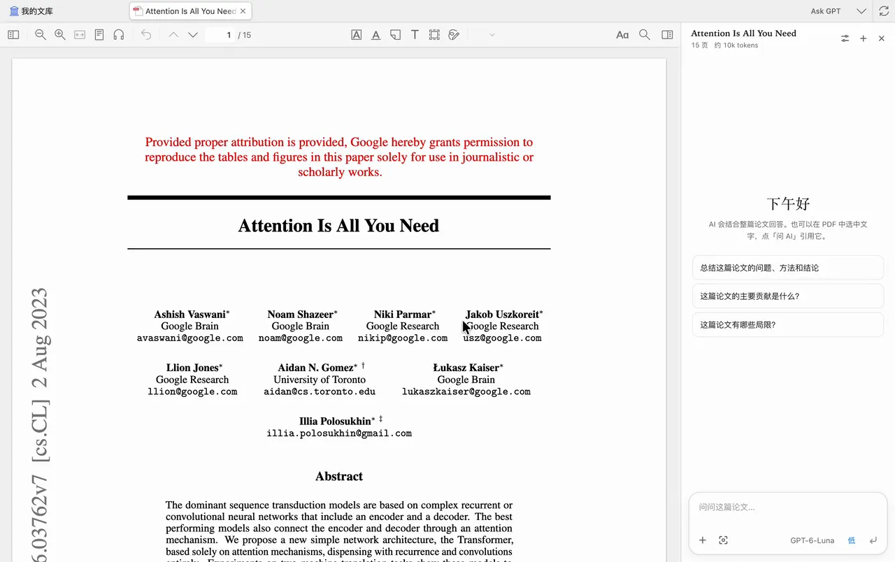

# Zotero Ask GPT

Zotero 的 PDF 问答插件。通过本机的 Codex CLI 提问，支持引用原文、截图和添加其他论文。

演示论文：[Attention Is All You Need](https://arxiv.org/abs/1706.03762)（Vaswani 等，2017）。

## 快速开始

### 安装

需要 Zotero 10.x 和 Codex CLI ≥ 0.167.0。目前只在 macOS 上测试过。

1. [安装 Codex CLI](https://github.com/openai/codex#installing-and-running-codex-cli)，在终端运行 `codex`，用 ChatGPT 账号登录。
2. [下载最新版 `.xpi`](https://github.com/zkforge/zotero-ask-gpt/releases/latest/download/zotero-ask-gpt.xpi)。
3. 在 Zotero 中打开「工具 → 插件」，把 `.xpi` 拖进插件窗口，重启 Zotero。

### 使用

打开一篇 PDF，点击工具栏上的 **Ask GPT**，或按 `⌘⇧G`。

- 选中文字，点「问 AI」，将选区带入下一条问题。
- 点输入框旁的截图按钮，在 PDF 上框选图表或公式。可连续添加多张截图。
- 点 `+`，按标题、作者或年份搜索文库。选择带 PDF 的条目后，可以和当前论文一起提问。
- 点击回答中的页码跳到原文。匹配到引用短语时会高亮原句。
- 点击「存为笔记」保存回答，笔记里的页码仍可点击。
- 重新打开 PDF 会恢复对话。最后一轮可以编辑问题或重新生成回答。

## 设置

「Zotero 设置 → Ask GPT」里可以设置 Codex 路径、代理、回答语言和提示词。连接失败时先点「测试连接」。如果提示找不到 Codex，在终端运行 `command -v codex`，把输出的路径填进去。

## 数据

对话和截图保存在 Zotero 数据目录下的 `ai-chat/`。提问时，Codex 会把当前及附加论文的可提取正文、截图和对话上下文发给模型服务。扫描版 PDF 如果没有文本层，可以用截图提问。

## 开发

开发安装、测试命令和实现见 [设计文档](docs/design.md)。问题和建议请发到 [GitHub Issues](https://github.com/zkforge/zotero-ask-gpt/issues)。

项目采用 [MIT 许可证](LICENSE)。第三方依赖的许可证随源码附带。[KaTeX](content/vendor/katex/LICENSE) · [marked](content/vendor/marked.LICENSE.md)
